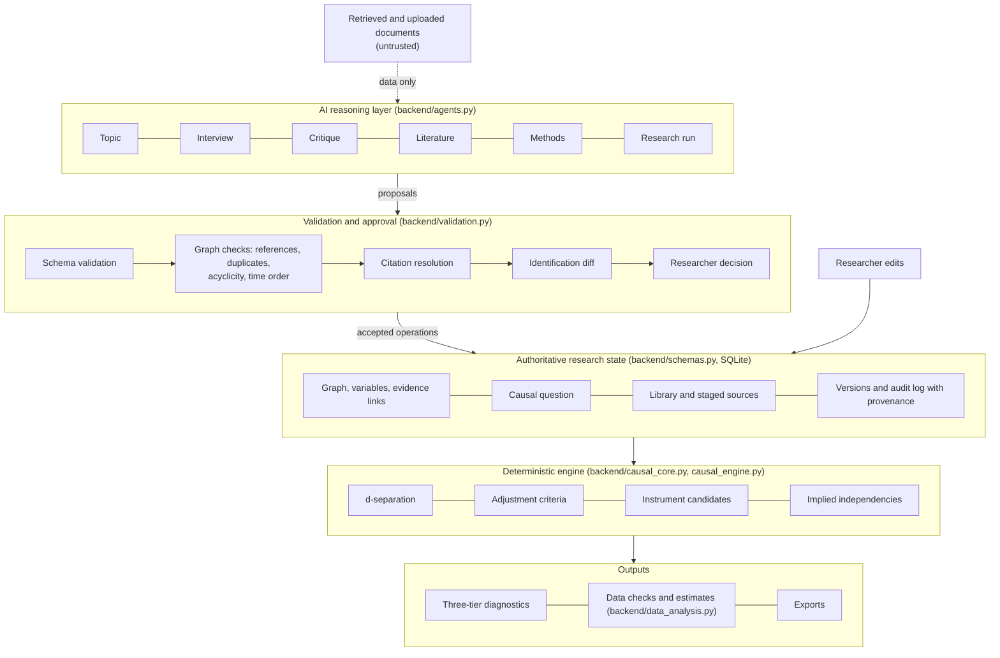

# DAG Brain: architecture

This document describes how DAG Brain is built and why. Its central idea is a strict separation between **AI reasoning**, which may be wrong, and the **authoritative research state**, which changes only through validated, researcher-approved operations and is analysed only by deterministic, tested mathematics.

Contents:

1. [Layers](#1-layers)
2. [Authoritative research state](#2-authoritative-research-state)
3. [Validation and approval](#3-validation-and-approval)
4. [Causal engine](#4-causal-engine)
5. [Data checks and estimation](#5-data-checks-and-estimation)
6. [AI reasoning layer](#6-ai-reasoning-layer)
7. [Untrusted content and prompt injection](#7-untrusted-content-and-prompt-injection)
8. [Literature and full text](#8-literature-and-full-text)
9. [Network boundary and local-only mode](#9-network-boundary-and-local-only-mode)
   - [AI drafts and their evaluation](#9a-ai-drafts-and-their-evaluation)
10. [Verification](#10-verification)
11. [Limitations](#11-limitations)
12. [References](#12-references)

---

## 1. Layers

The flow for any AI-originated change:

1. The model proposes a structured operation (add a variable, add an arrow, add a source).
2. The application validates it against the current state and computes what would change in identification.
3. The researcher accepts or rejects it.
4. On acceptance it is re-validated against the graph as it is now, applied, and recorded as a new graph version.
5. The engine recomputes from the new state.
6. The proposal, the decision and the model's provenance remain in the audit log.

Direct edits by the researcher in the interface go straight to the state (the researcher is the authority), and they too create versions.

## 2. Authoritative research state

`backend/schemas.py` defines the state as Pydantic models stored as one JSON document per study in SQLite (WAL mode). Schema version 2 adds:

| Model | Purpose |
|:--|:--|
| `CausalNode` | Variable with role, time wave, observed flag, measurement description. |
| `CausalEdge` | `edge_type` (directed or bidirected, a shared unmeasured cause), `evidence_class`, `contested`, `evidence_links`, `origin` (researcher, ai, import). |
| `EvidenceLink` | One study's bearing on one edge: design, population, `directionality` (established, not established, unclear), limitations, `researcher_assessment` (supports, weakly supports, contradicts, not assessed), and who extracted it. |
| `PaperAISummary` | Machine reading notes, `extracted_by` (ai or heuristic), `directionality`, and `verified`, which only the researcher sets. |
| `CitationSource` | Bibliographic record, legal full-text locations (`oa_url`, `europepmc_url`, `proxy_url`, `local_pdf`), `injection_flags`, `added_by`. |
| `GraphPatchProposal` | Proposed operation plus `validation` (errors, warnings, identification diff), `provenance`, and decision fields. |
| `Provenance` | Agent mode, provider, model, whether an LLM was used, SHA-256 of the prompt, source ids in context. |
| `GraphVersion` | Snapshot of nodes and edges after each change (the last 60 are kept). |
| `ResearchQuestion` | Domain-neutral question: units, exposure, comparator, outcome, time horizon, estimand, setting, framing template. |
| `DatasetMeta` | Uploaded dataset, column profile and the variable-to-column mapping. |

Evidence classes: `experimental`, `quasi_experimental`, `empirical_association`, `mechanistic`, `author_hypothesis`, `researcher_hypothesis`, `ai_hypothesis`.

**Migration.** Version 1 stored a single `epistemic_status`. A `model_validator` on `CausalEdge` migrates it on load:

| v1 status | v2 representation |
|:--|:--|
| `empirical` | `empirical_association` |
| `hypothesized` | `researcher_hypothesis` |
| `ai_proposed` | `ai_hypothesis`, origin `ai` |
| `contested` | `researcher_hypothesis`, `contested = true` |
| `bidirectional_confounded` | `edge_type = bidirected` |

Legacy citation ids become `EvidenceLink`s with assessment "not assessed". Unknown legacy fields (such as the removed Sci-Hub URL) are dropped.

## 3. Validation and approval

`backend/validation.py` is the only path by which AI output reaches the state.

- `intake_proposals(project, raw, provenance)` schema-validates each raw proposal (malformed ones are discarded and logged), forces AI arrows to `evidence_class = ai_hypothesis` and `approved_by_researcher = false`, attaches provenance, and runs `validate_proposal`. Proposals that fail are kept with status `invalid`, so the researcher can see what was attempted and why it was refused.
- `validate_proposal(project, proposal)` never mutates state. It checks:
  - ids and labels;
  - that referenced variables exist;
  - no self-loops and no duplicates;
  - acyclicity on a trial graph;
  - time order (warning only);
  - that every cited source id is in the library or among the staged sources.

  It also computes an **identification diff**: whether identifiability, the minimal adjustment sets or the validity of the current adjustment would change.
- `apply_proposal` re-validates against the current graph, because it may have changed since the proposal was made. It applies the change, promotes cited staged sources into the library, records a `GraphVersion` and writes an audit entry carrying the proposal id and provenance. If validation fails, the API returns 409 with the reasons.
- `reject_proposal` records the decision and reason.

Research runs never write to the library. They place papers in `staged_sources`, which the researcher adds or discards one by one.

## 4. Causal engine

`backend/causal_core.py` contains pure graph algorithms with no dependency on the app's data model. `backend/causal_engine.py` adapts the state to it and formats results.

### 4.1 Representation

Directed edges are taken as they are. A bidirected edge `a ↔ b` becomes `a ← U_ab → b`, with `U_ab` latent. Nodes marked unobserved are latent. Every computation is therefore ordinary DAG theory over observed and latent variables. Only arrows approved by the researcher enter the graph.

### 4.2 d-separation

Implemented with `networkx.is_d_separator` and cross-checked against an independent ancestral moral-graph implementation (Lauritzen et al. 1990).

### 4.3 Total effect: generalised adjustment criterion

For exposure x and outcome y, let cn(x, y) be the nodes other than x on proper causal paths from x to y, and Forb(x, y) = De(cn(x, y)) ∪ {x}. A set Z of observed variables is a valid adjustment set if and only if:

1. Z ∩ Forb(x, y) = ∅, and
2. Z d-separates x and y in the proper back-door graph, which is the graph with the first edge of every proper causal path from x to y removed.

This criterion is sound and complete for DAGs (Shpitser, VanderWeele & Robins 2010; Perković et al. 2018): if any set identifies the effect by covariate adjustment, it satisfies the criterion. Pearl's back-door criterion is a special case.

**Existence** is decided exactly: a valid set exists if and only if the canonical set Adjust(x, y) = (An({x, y}) ∩ observed) − ({x, y} ∪ Forb(x, y)) is valid (van der Zander, Liśkiewicz & Textor 2019).

**Minimal sets** are enumerated smallest first, with superset pruning, over observed ancestors of {x, y} (minimal separators lie within them). The result reports `search_complete = false` if the search budget is exhausted.

### 4.4 Direct effect: single-door criterion

Z identifies the path coefficient of x → y in a linear SEM if and only if Z contains no descendant of y and Z d-separates x and y in the graph with x → y removed (Pearl 2009, Theorem 5.3.1). If there is no x → y edge the direct effect is zero. The interface labels this as a linear-model result; for non-linear models it corresponds to a controlled direct effect.

### 4.5 Instrument candidates

Z is reported as a candidate given W when:

- W contains no descendant of x;
- Z is d-connected to x given W;
- Z is d-separated from y given W once x's outgoing edges are removed (Brito & Pearl 2002; van der Zander et al. 2015).

These are necessary graphical conditions under the assumed DAG. The output is always labelled "graphical candidate", with a note that instrument strength, the exclusion restriction and the absence of instrument–outcome confounding are substantive assumptions the graph cannot verify.

### 4.6 Structural roles

| Role | Graphical definition |
|:--|:--|
| Mediator | descendant of x and ancestor of y |
| Confounder | ancestor of x and ancestor of y by a path not through x |
| Instrument (role) | ancestor of x that is not an ancestor of y except through x |
| Competing exposure | ancestor of y that is neither an ancestor nor a descendant of x |
| Descendant of the outcome / of the exposure | as named |

(An earlier version labelled every ancestor of x a confounder; that bug is covered by a regression test.)

### 4.7 Testable implications

For every non-adjacent pair of observed variables (variables sharing a latent parent count as adjacent), the engine finds a minimal separating set of observed variables (`networkx.find_minimal_d_separator`). Each statement a ⊥ b | S is implied by the DAG and can be tested against data.

### 4.8 Paths for explanation

`explain_paths` lists the paths between x and y with their colliders, blockers and opened colliders, collapsing latent forks to `↔`. It is for explanation only, capped at 400 paths and flagged when truncated. **No validity decision uses path enumeration.** (An earlier version decided validity by enumerating paths capped at 10 edges, which hid longer open paths; there is a regression test for this.)

### 4.9 Three-tier diagnostics

`run_diagnostics` returns the legacy keys used by the interface plus:

- `structural`: acyclicity, cycles, temporal violations, latent variables, bidirected edges, whether paths were truncated.
- `identification`: status, criterion, whether the current set is valid, whether the search is complete, the instrument note, and `assumes`, the list of assumptions every identification result depends on.
- `scientific_support`: for every arrow among ancestors of x and y, its evidence class, citations, researcher-supported links, whether direction is established, and the reasons it counts as weak. A note reminds the reader that missing arrows are assumptions too.

## 5. Data checks and estimation

`backend/data_analysis.py`. Datasets are CSV files stored under `data/uploads/<study>/data/`; one dataset is active per study, and variables are mapped to columns automatically by name, then adjusted by the researcher.

### 5.1 Testing implied independencies

For each implication whose variables are all mapped, on complete cases:

- **Partial correlation with Fisher's z**: exact under joint normality.
- **Generalised covariance measure** (Shah & Peters 2020): the normalised mean of the product of residuals from cross-fitted gradient-boosted regressions of a on S and of b on S. It is valid under weak conditions when the regressions are consistent, and it handles non-linear dependence on S.

"Automatic" uses the GCM when n ≥ 500 and S is non-empty, and partial correlation otherwise. P-values are corrected with Holm (family-wise error) and Benjamini–Hochberg (false discovery rate), and decisions use Holm. Results are worded as "contradicted by" or "consistent with" the data.

### 5.2 Estimation

The server refuses to estimate unless the engine has certified an adjustment set. It uses the current set if valid, otherwise the first minimal set. It also refuses when a required variable is unmapped.

| Estimator | Use | Details |
|:--|:--|:--|
| Regression adjustment | always | OLS with HC3 robust standard errors and a 200-replicate percentile bootstrap |
| Partially linear DML | continuous exposure | θ in y = θx + g(Z) + ε. Residualise y and x on Z with 5-fold cross-fitted gradient boosting; θ = Σ r̃ₓr̃ᵧ / Σ r̃ₓ²; influence-function standard error (Robinson 1988; Chernozhukov et al. 2018) |
| AIPW (DML) | binary exposure | Cross-fitted propensity and outcome models (gradient boosting); propensities clipped to [0.01, 0.99] with the count reported; average treatment effect with influence-function SE; risk ratio with delta-method CI when the outcome is binary |

### 5.3 Sensitivity

E-values (VanderWeele & Ding 2017) for the point estimate and the confidence limit closest to the null. Binary outcomes use the risk ratio. Continuous outcomes use the approximation RR ≈ exp(0.91 d) for the standardised effect d (per standard deviation of a continuous exposure).

## 6. AI reasoning layer

`backend/agents.py` with `backend/llm_router.py`. Modes:

| Mode | Role |
|:--|:--|
| Topic | Domain-neutral question formulation (units, exposure, comparator, outcome, time horizon, estimand). Discipline framings (PICO, PECO, policy counterfactuals, interventions on an SCM, longitudinal or mediation) are applied only when they fit. |
| Interview | Clarifies variables, measurement and time order. |
| Critique | Reviewer 2: confounding, colliders, reverse causation, selection. |
| Literature | Summarises evidence, stating each study's evidence class and whether it establishes direction. |
| Methods | Drafts identification and methods text from engine results. |
| Research run | Multi-query search; stages sources; proposes AI-hypothesis arrows citing staged sources. |

The system prompt states that the model can only propose, must classify evidence, must cite only ids present in the context, and must not compute or contradict graph properties. With no model configured, a deterministic co-pilot answers from engine results. Model output is parsed as JSON; anything malformed is discarded.

The paper summariser reports only what the text states, phrases associations as associations, and returns `directionality`. The design caps it: cross-sectional, case-control and theoretical designs are always "not established". The keyword fallback (`extracted_by = heuristic`) never invents adjusted variables or causal claims; it reports only a first sentence, the detected design and a design-level caveat.

## 7. Untrusted content and prompt injection

`backend/untrusted.py`. Retrieved abstracts, web snippets, uploaded PDF text and any summaries of them are untrusted.

1. **Isolation.** Content enters prompts only inside `<untrusted_document id=… kind=…>` blocks, with a length cap, control characters removed and any delimiter look-alikes replaced. The system prompt declares these blocks inert and tells the model to report, not follow, instructions found in them.
2. **Detection.** `scan()` flags content that tries to override instructions, change role, imitate chat roles, inject delimiters, mimic the output schema, instruct graph changes, mention credentials or claim new instructions. Flags are stored on the source, shown in the interface, and exclude the source from automatic proposals and from AI citations.
3. **Structure.** This is the guarantee that does not depend on the model. Output can only become proposals, proposals pass validation, citations must resolve to known ids, and nothing changes without the researcher's decision.

## 8. Literature and full text

Search adapters: OpenAlex, Crossref, Europe PMC (PubMed), CORE, optional Semantic Scholar, SerpApi for Google Scholar, and Tavily or SearXNG for the web. Study design is detected from keywords and labelled as such.

Full text is found only through legitimate routes:

- **Unpaywall** (best open-access location by DOI, using the configured contact email);
- **Europe PMC** open-access full text when a PMC id is available;
- **CORE**;
- an optional institutional **EZproxy** prefix;
- **uploaded PDFs**, parsed locally with `pypdf`: text, title and DOI, with the injection scan applied.

Sci-Hub support has been removed.

## 9. Network boundary and local-only mode

Every outbound HTTP request from the backend goes through `backend/net.py`. When `OFFLINE_MODE` is on (environment variable or runtime setting), a request hook refuses any host other than this machine before the request is sent, raising `OfflineBlocked`. Literature adapters treat that as "no results". The LLM router falls back to the deterministic co-pilot unless the model is local (Ollama, LM Studio). The frontend loads web fonts only when the server reports local-only mode is off, and shows a "Local only" badge when it is on.

This is local-only operation of the application. An air-gapped deployment additionally needs the host's network, operating system, browser and package sources to be controlled. See the README.

## 9a. AI drafts and their evaluation

**Drafting** (`agents.draft_dag`). The model drafts a whole DAG from the research question (text-to-DAG) or from library sources and uploaded PDFs (PDF-to-DAG). Sources flagged for injection are left out, and documents are passed as untrusted blocks. `sanitize_draft` turns the output into a valid DAG and records each repair as a note:
- unknown variables and self-loops are dropped;
- arrows that would close a cycle are dropped;
- a second exposure or outcome is relabelled;
- citations that do not resolve are removed.

The draft is stored as a worldview of kind `ai_draft`, with provenance. It never touches the study's graph; loading it is an explicit researcher action, versioned and undoable. With no model available, a baseline draft (exposure → outcome) is stored and labelled as such.

**References.** An expert graph is imported as DAGitty code into a worldview of kind `reference`, or a snapshot is marked as one.

**Evaluation** (`backend/dag_eval.py`). It compares a candidate graph with a reference graph.

Variables are matched by normalised id or label, then by string similarity (threshold 0.82), with an optional manual mapping. Reference variables the candidate lacks are added to it as isolated variables. Candidate variables the reference lacks are kept as unobserved, so paths through them still count.

| Metric | Definition |
|:--|:--|
| Skeleton precision, recall, F1 | Over adjacencies, ignoring direction; bidirected edges count as adjacencies |
| Oriented-edge precision, recall, F1 | Direction (or bidirected type) must match |
| Structural Hamming distance | Missing adjacencies + extra adjacencies + shared adjacencies with a different orientation |
| Adjustment identification distance (parent and ancestor) | Share of ordered pairs (x, y) of observed reference variables for which the strategy read off the candidate is wrong in the reference: claim of no effect when y is not a descendant of x, else an adjustment set (the parents of x, or the canonical ancestor set), else "not identifiable". Correctness is judged with the complete adjustment criterion in the reference (Henckel, Würtzen & Weichwald 2024). |
| Target analysis correct | For the reference exposure and outcome: the candidate's first minimal adjustment set is valid in the reference, or both graphs agree that adjustment cannot identify the effect |

The ancestor version of the AID adjusts for every ancestor and can be lenient: it may pick up a confounder by chance that the candidate's minimal set omits. That is why the target-level verdict, which uses the set the app would actually recommend, is reported alongside it.

**Benchmark** (`scripts/benchmark_extraction.py`). Each case in `benchmarks/cases/` supplies a question, the exposure and outcome names, and a reference graph with its source. The drafter sees only the question and the two names. Results, the model used and the date go to `docs/BENCHMARK.md`.

## 10. Verification

- `tests/` (pytest):
  - textbook graphs;
  - random-DAG cross-checks against independent reference implementations in `tests/reference.py` (moral-graph d-separation, path-based adjustment criterion, Pearl's back-door);
  - exact population-covariance proofs on random linear SEMs, plus finite-sample recovery;
  - estimator and test calibration on simulated data with known truth;
  - the validation and approval boundary;
  - prompt-injection handling;
  - schema migration;
  - the offline guard.
- `scripts/validation_report.py`: the full study behind [docs/VALIDATION.md](docs/VALIDATION.md), with a fixed seed.
- `tests/test_dag_eval.py` and `tests/test_drafting.py`: evaluation metrics on cases with known answers, draft sanitising, injection exclusion, and the draft-then-evaluate API flow.
- `scripts/benchmark_extraction.py`: the AI-drafting benchmark behind [docs/BENCHMARK.md](docs/BENCHMARK.md).

## 11. Limitations

- One exposure and one outcome; identification by covariate adjustment, plus graphical instrument candidates. There is no front-door estimation, no do-calculus identification beyond adjustment, and no g-methods for time-varying treatments.
- The direct effect is the single-door, linear-SEM notion.
- Estimation covers the total effect with complete-case analysis. There is no multiple imputation and no clustered or survey designs.
- Conditional-independence tests have finite power. Markov-equivalent graphs cannot be distinguished by data.
- Study-design detection is keyword-based, and AI summaries can be wrong; both are labelled and must be verified.
- Storage is single-user SQLite with no authentication. Do not expose the server to untrusted networks.

## 12. References

- Brito, C. & Pearl, J. (2002). Generalized instrumental variables. *UAI*.
- Henckel, L., Würtzen, T. & Weichwald, S. (2024). Adjustment identification distance: a gadjid for causal structure learning. arXiv:2402.08616.
- Hernández-Díaz, S., Schisterman, E. F. & Hernán, M. A. (2006). The birth weight "paradox" uncovered? *American Journal of Epidemiology* 164(11).
- Chernozhukov, V. et al. (2018). Double/debiased machine learning for treatment and structural parameters. *The Econometrics Journal* 21(1).
- Greenland, S., Pearl, J. & Robins, J. M. (1999). Causal diagrams for epidemiologic research. *Epidemiology* 10(1).
- Holm, S. (1979). A simple sequentially rejective multiple test procedure. *Scandinavian Journal of Statistics* 6(2).
- Benjamini, Y. & Hochberg, Y. (1995). Controlling the false discovery rate. *JRSS B* 57(1).
- Lauritzen, S. L., Dawid, A. P., Larsen, B. N. & Leimer, H.-G. (1990). Independence properties of directed Markov fields. *Networks* 20(5).
- Pearl, J. (2009). *Causality*, 2nd ed. Cambridge University Press.
- Perković, E., Textor, J., Kalisch, M. & Maathuis, M. H. (2018). Complete graphical characterization and construction of adjustment sets in Markov equivalence classes of ancestral graphs. *JMLR* 18(220).
- Robinson, P. M. (1988). Root-N-consistent semiparametric regression. *Econometrica* 56(4).
- Shah, R. D. & Peters, J. (2020). The hardness of conditional independence testing and the generalised covariance measure. *Annals of Statistics* 48(3).
- Shpitser, I., VanderWeele, T. J. & Robins, J. M. (2010). On the validity of covariate adjustment for estimating causal effects. *UAI*.
- van der Zander, B., Liśkiewicz, M. & Textor, J. (2019). Separators and adjustment sets in causal graphs: complete criteria and an algorithmic framework. *Artificial Intelligence* 270.
- van der Zander, B., Textor, J. & Liśkiewicz, M. (2015). Efficiently finding conditional instruments for causal inference. *IJCAI*.
- VanderWeele, T. J. & Ding, P. (2017). Sensitivity analysis in observational research: introducing the E-value. *Annals of Internal Medicine* 167(4).
