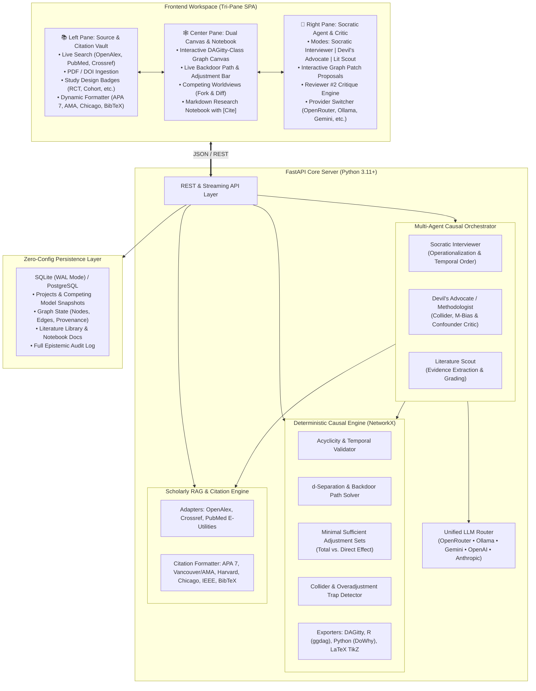

# DAG_Brain (Causal Studio): System Architecture & Technical Specification

> **An Open-Source, Self-Hostable, AI-Assisted Causal Modelling & Research Notebook Environment**  
> Combining the mathematical rigor of **DAGitty**, the source-grounded synthesis of **NotebookLM**, and a **Socratic Multi-Agent Research Collaborator**.

---

## 1. Executive Summary & Core Philosophy

Most tools for Directed Acyclic Graphs (DAGs) fall into one of two flawed extremes:
1. **Pure Drawing / Math Tools (e.g., DAGitty, Graphviz):** Mathematically sound for finding adjustment sets, but offer zero assistance in *discovering* variables, interrogating unmeasured confounding, searching empirical literature, or documenting why an edge exists.
2. **One-Shot AI Diagram Generators:** Convert a text prompt into a pretty graph, frequently hallucinating causal directions, conflating correlation with causation, ignoring time-ordering ($t_0 \prec t_1 \prec t_2$), and leaving the researcher with an unauditable black box.

**DAG_Brain** bridges this gap. It treats a Causal DAG not as a static picture, but as a **living, auditable scientific argument** where:
- Every **Node** has a formal causal role, operational definition, measurement scale, and temporal index.
- Every **Edge** carries an **Epistemic Status** (`Empirical`, `Hypothesized`, `AI-Proposed`, `Contested`, `Bi-directed / Latent Confounded`) backed by structured **Literature Evidence Cards** and study-design ratings (`RCT`, `Cohort`, `Cross-Sectional`, `IV/MR`, `Expert Consensus`).
- The **AI Co-Investigator** never mutates the graph silently. Instead, it conducts a Socratic interview, searches scholarly databases, runs deterministic graph checks, and submits **Structured Graph Proposals** (`GraphPatchProposal`) that the researcher can inspect, accept, flip, or reject.

---

## 2. High-Level System Architecture

DAG_Brain is designed around a **Zero-Friction, Single-Command Self-Hostable Architecture** (`start.bat` / `start.sh` or `docker compose up`) that scales cleanly from a single researcher's laptop (running local Ollama or OpenRouter) to a multi-user university lab deployment.



---

## 3. Deep Component Specifications

### 3.1 Deterministic Causal Mathematics Engine (`backend/causal_engine.py`)

A core architectural rule of DAG_Brain is: **LLMs never compute graph properties.** All causal graph properties are computed deterministically in Python using graph theory (`NetworkX` + pearlian d-separation algorithms):

1. **Structural Validation & Temporal Consistency:**
   - Enforces strict acyclicity ($\nexists$ directed cycle $v_0 \to v_1 \to \dots \to v_0$). If a proposed edge introduces a cycle, the engine identifies the exact cycle path and suggests modeling time-indexed nodes ($X_{t_0} \to Y_{t_1} \to X_{t_2}$).
   - Validates temporal ordering when `time_index` is specified on nodes (forbidding causal arrows from the future to the past).
2. **Backdoor Path Enumeration & d-Separation Solver:**
   - Given Exposure $X$, Outcome $Y$, and Conditioned/Adjusted set $Z$:
   - Enumerates all undirected paths between $X$ and $Y$.
   - Classifies each path as:
     - **Directed Causal Path** ($X \to \dots \to Y$): Frontdoor/mediated pathway.
     - **Backdoor Path** ($X \leftarrow \dots Y$): Potential confounding pathway.
     - **Collider Path**: Contains at least one node $C$ with converging arrows ($\to C \leftarrow$).
   - Applies **Pearl's d-separation rules** given adjustment set $Z$:
     - A non-collider along a path is **blocked** if it is in $Z$.
     - A collider $C$ along a path is **blocked** *unless* $C \in Z$ or $descendants(C) \cap Z \neq \emptyset$ (which opens the path and induces **Collider Bias / M-Bias**).
3. **Minimal Sufficient Adjustment Set Finder:**
   - Computes valid adjustment sets $Z$ that:
     1. Contain no descendants of $X$ on a causal path to $Y$ (for **Total Effect**), or properly block mediated paths (for **Direct Effect**).
     2. Block all backdoor paths between $X$ and $Y$ without conditioning on unobserved/latent variables ($U$).
   - Returns all **minimal sufficient adjustment sets** (sorted by cardinality and observability).
4. **Automated Bias & Trap Diagnostics:**
   - **Overadjustment Warning:** Triggers when a researcher adjusts for a **Mediator** ($X \to M \to Y$) while estimating a Total Effect, or adjusts for a descendant of the Outcome.
   - **Collider Bias Warning (Berkson's / M-Bias):** Triggers when a node in the `adjusted` set is a collider or descendant of a collider, showing the exact biasing path opened.
   - **Unmeasured Confounding Alert:** Identifies when an open backdoor path passes strictly through `latent/unobserved` nodes, making the effect unidentifiable via standard regression adjustment and recommending **Instrumental Variables (IV)**, **Frontdoor Adjustment**, or **Sensitivity Analysis (E-value)**.
5. **Instrumental Variable (IV) Candidate Discovery:**
   - Scans the graph for nodes $I$ satisfying structural IV criteria relative to $(X, Y)$:
     - Relevance: Directed path from $I \to X$.
     - Exclusion Restriction: All directed paths from $I$ to $Y$ pass through $X$.
     - Exchangeability: No open backdoor path between $I$ and $Y$.

---

### 3.2 Multi-Agent Socratic Orchestrator (`backend/agents.py`)

Rather than a single generic prompt, the AI layer operates through three specialized personas that inspect the live graph state, the researcher's notebook, and the citation vault:

| Agent Persona | Primary Responsibility | Behavioral Guardrails |
| :--- | :--- | :--- |
| **1. Socratic Interviewer** | Guides the researcher from a vague research question to well-defined variables, temporal ordering, and causal mechanisms. | Asks 1–3 high-leverage methodological questions per turn. Refuses to dump 15 unverified nodes at once. |
| **2. Devil's Advocate (Reviewer #2)** | Actively stress-tests the current DAG. Looks for omitted confounders, reverse causation, selection/attrition bias, and measurement error. | Explicitly references the live `CausalEngine` diagnostics (e.g., open backdoor paths, collider traps) and challenges weak assumptions. |
| **3. Literature Scout** | Searches OpenAlex, Crossref, and PubMed for empirical papers testing specific edges ($A \to B$), extracts study design metadata, and links citations to edges. | Distinguishes observational correlation from causal identification (RCT, DiD, IV, Cohort). Never fabricates DOIs—verifies against retrieved metadata. |

#### Structured Output Protocol
Every AI response returns both conversational Markdown and a structured payload:
```json
{
  "reply_markdown": "Socratic response with inline citations...",
  "socratic_questions": [
    "Is 'Chronic Stress' measured prior to 'Sleep Deprivation' (baseline confounder) or after (mediator)?"
  ],
  "proposals": [
    {
      "action": "add_node",
      "node": { "id": "shift_work", "label": "Shift Work Schedule", "role": "confounder" },
      "rationale": "Common cause of both disrupted sleep architecture and metabolic/cognitive outcomes."
    },
    {
      "action": "add_edge",
      "edge": {
        "source": "shift_work",
        "target": "sleep_deprivation",
        "epistemic_status": "empirical",
        "mechanism": "Circadian misalignment reduces slow-wave and REM sleep duration.",
        "confidence": 0.88
      },
      "rationale": "Supported by longitudinal occupational cohort studies."
    }
  ],
  "notebook_append_suggestion": "## Confounding via Circadian Disruption\n..."
}
```

---

### 3.3 Universal LLM Provider Layer (`backend/llm_router.py`)

DAG_Brain supports a zero-lock-in BYOK and Local AI architecture:
1. **OpenRouter (`openrouter`)**: First-class integration (`https://openrouter.ai/api/v1/chat/completions`) with custom attribution headers (`HTTP-Referer`, `X-Title`), allowing seamless switching between `anthropic/claude-3.7-sonnet`, `google/gemini-2.5-pro`, `deepseek/deepseek-r1`, `openai/gpt-4o`, or free OpenRouter models.
2. **Ollama (`ollama`)**: Local auto-discovery (`GET http://localhost:11434/api/tags`) and execution for 100% private, air-gapped institutional research.
3. **Google Gemini (`gemini`)**: Native Gemini API support.
4. **OpenAI / Custom OpenAI-Compatible (`openai`)**: Works with OpenAI, LM Studio, vLLM, and university-hosted endpoints.
5. **Built-in Deterministic Causal Co-Pilot Fallback**: If no API key or local LLM is running yet, DAG_Brain uses a built-in rule-based Socratic & Graph-Theoretic analyzer so the application remains 100% interactive out of the box.

---

### 3.4 Scholarly Literature & Multi-Style Citation Engine (`backend/literature_service.py`)

To provide a true **NotebookLM-for-Science** experience:
- **Multi-Source Federated Search:** Queries **OpenAlex** (250M+ works, open abstracts via inverted-index reconstruction), **Crossref**, and **PubMed (NCBI E-utilities)** simultaneously without requiring paid API keys.
- **Automated Study Design Classifier:** Parses titles/abstracts to tag papers with methodological hierarchy badges:
  - `Meta-Analysis / Systematic Review`
  - `Randomized Controlled Trial (RCT)`
  - `Quasi-Experimental (IV / DiD / RDD / MR)`
  - `Longitudinal / Cohort`
  - `Cross-Sectional / Observational`
- **Dynamic Multi-Style Citation Formatter:** Instantaneously formats any citation vault item or edge reference list into:
  - **APA 7th Edition** (Psychology, Social Sciences, Education)
  - **AMA / Vancouver** (Epidemiology, Medicine, Public Health)
  - **Chicago (Author-Date)** (Economics, History, Policy)
  - **Harvard** (Business, International Sciences)
  - **IEEE** (Computer Science, Engineering, AI)
  - **BibTeX** (LaTeX / Overleaf export)

---

### 3.5 Competing Worldviews (Model Forking & Diffing)

In real research, causal assumptions are contested (e.g., *"Is Socioeconomic Status a confounder or an upstream determinant mediated by neighborhood environment?"*).
DAG_Brain allows researchers to:
1. **Snapshot / Fork** the current DAG into named competing hypotheses (`Model A: Direct Confounding` vs. `Model B: Mediated Pathway`).
2. **Compare Worldviews** to see how flipping an arrow or changing a node from `Confounder` to `Mediator` or `Latent` alters the **Minimal Sufficient Adjustment Sets** and **Identifiability**.

---

## 4. Export & Interoperability Matrix

| Export Format | Target Ecosystem | Contents |
| :--- | :--- | :--- |
| **DAGitty Syntax (`dag { ... }`)** | `dagitty.net` / R `dagitty` | Full node roles (`[exposure]`, `[outcome]`, `[adjusted]`, `[latent]`), layout positions, and directed edges. |
| **R Script (`.R`)** | RStudio (`dagitty` + `ggdag`) | Reproducible R code to plot the DAG, test d-separation implications, and print adjustment sets. |
| **Python Script (`.py`)** | `DoWhy` / `NetworkX` | Ready-to-run `CausalModel(data=df, treatment=..., outcome=..., graph=...)` script. |
| **LaTeX (`TikZ`)** | Overleaf / Academic Journals | Vector `tikzpicture` code styled by causal role. |
| **Comprehensive Research Dossier (`.md`)** | Supplementary Material / Preregistration | Complete research question, DAG summary, adjustment sets, edge-by-edge rationale table, researcher notebook, and formatted bibliography in the user's chosen citation style. |
