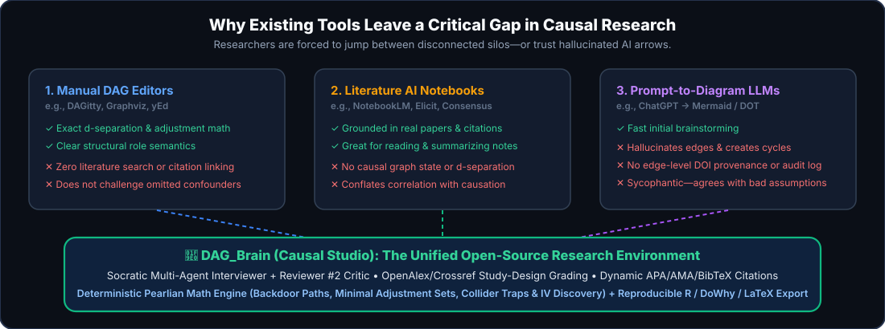
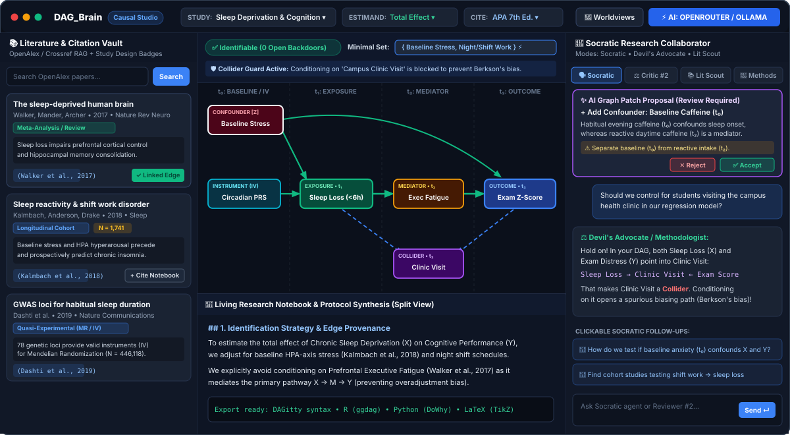
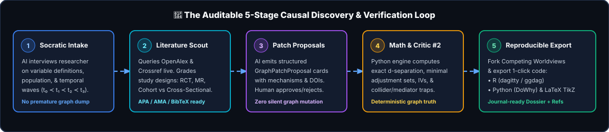
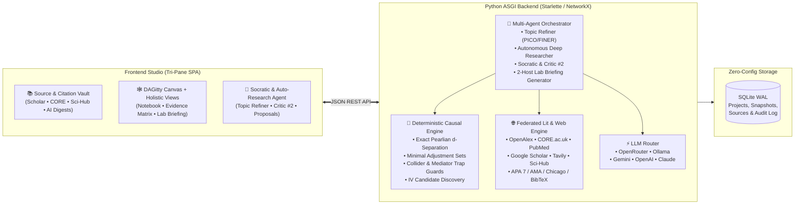

<div align="center">


# 🧠 DAG_Brain (Causal Studio)

**The Open-Source, Self-Hostable AI Causal Modelling, DAGitty Math Engine & Research NotebookLM Environment**

[](LICENSE)
[](pyproject.toml)
[](#-one-click-self-hosted-quickstart)
[](#-universal-ai-provider-router-openrouter--ollama--byok)
[](#-federated-scholarly--internet-search-integrations)
[](CONTRIBUTING.md)

[**Why DAG_Brain?**](#-the-gap-were-filling) •
[**Visual Tour**](#-visual-workspace-tour) •
[**Scholarly & Web Integrations**](#-federated-scholarly--internet-search-integrations) •
[**Holistic NotebookLM Features**](#-holistic-research-notebooklm-capabilities) •
[**1-Click Quickstart**](#-one-click-self-hosted-quickstart) •
[**Contribute**](#-join-the-project--contribute)

</div>

---

## 🎯 The Gap We're Filling

Constructing a **Directed Acyclic Graph (DAG)** is one of the most consequential steps in empirical research—whether you are in **Epidemiology, Economics, Psychology, Clinical Medicine, Operations Research, or Causal ML**. Get the graph wrong, and your statistical regression will suffer from **unmeasured confounding**, **overadjustment on a mediator**, or **collider stratification bias (Berkson's / M-bias)**.

Yet today's research tooling forces authors into three disconnected silos:

<div align="center">



</div>

1. **Manual Graph Calculators (e.g., DAGitty):** Mathematically rigorous at computing $d$-separation and adjustment sets *after* you know the graph, but offer **zero help** in narrowing a research topic, interrogating omitted variables, searching empirical literature, or documenting *why* each arrow exists.
2. **Literature Synthesis Tools (e.g., Google NotebookLM, Elicit):** Great for reading papers and generating summaries, but have **no formal graph state** or causal identification engine—frequently conflating observational correlation with causal direction.
3. **One-Shot AI Diagram Generators (e.g., Prompt $\to$ Mermaid):** Ask a generic LLM to draw a causal DAG and it will hallucinate edges, ignore temporal ordering ($t_0 \prec t_1 \prec t_2 \prec t_3$), invent citations, and sycophantically agree with flawed assumptions.

### 💡 Enter **DAG_Brain (Causal Studio)**
**DAG_Brain** unites all three worlds into a single, free, self-hostable research environment. It treats a Causal DAG not as a static drawing, but as an **auditable scientific argument** where:
- Broad ideas are narrowed into formal **PICO/PECO & FINER** causal questions,
- Autonomous AI agents search the live internet (**Tavily**, **SearXNG**) and scholarly databases (**Google Scholar**, **CORE.ac.uk**, **OpenAlex**, **PubMed/EuropePMC**, **Sci-Hub mirrors**),
- Saved papers receive instant **AI Executive Digests** (TL;DR, extracted causal claims, confounders controlled, and bias critiques),
- Every assumption is stress-tested by a **Socratic Interviewer & Reviewer #2 Critic**, and
- Every path is verified by a **deterministic Pearlian mathematical engine**.

---

## 🖥️ Visual Workspace Tour

<div align="center">



</div>

The **DAG_Brain Studio** is organized into a synchronized **Tri-Pane Research Workspace**:

| Workspace Pane | What It Does | Key Superpowers |
| :--- | :--- | :--- |
| **📚 Left Pane: Literature, Web & Full-Text Vault** | Federated search across **Google Scholar**, **CORE.ac.uk**, **PubMed/EuropePMC**, **OpenAlex**, & **Tavily Web** with 1-click full-text resolution. | • **✨ AI Executive Digest on Every Paper:** Instant TL;DR, extracted causal claims, confounders controlled, & bias warnings<br>• **Direct Full-Text Portals:** 1-click links to `scholar.google.com`, `core.ac.uk`, `sci-hub.name`, and publisher PDFs<br>• **Live Multi-Style Citation Engine:** Switch instantaneously between **APA 7th**, **AMA / Vancouver `[1]`**, **Chicago**, **Harvard**, **IEEE**, and **BibTeX** |
| **🕸️ Center Pane: Interactive DAGitty Canvas & Holistic Research Studio** | Build and mathematically validate your causal model alongside 6 integrated research views. | • **Real-time Pearlian $d$-Separation & Backdoor Banner** + 1-Click **Apply Minimal Adjustment Set**<br>• **📊 Evidence Synthesis Matrix:** Elicit-style comparative table of all saved papers<br>• **🎙️ 2-Host Audio Lab Briefing:** NotebookLM-style dialogue between *Lead PI* & *Methodologist Reviewer #2* with **Browser TTS Audio Playback**<br>• **Competing Worldviews:** Fork & diff alternative DAG hypotheses |
| **🧠 Right Pane: Autonomous & Socratic AI Collaborator** | Five specialized AI personas + a 1-click **🚀 Autonomous Deep Research** loop. | • **🎯 Topic Refiner:** Narrows broad topics into PICO/PECO & FINER causal models<br>• **🗣️ Socratic Interviewer:** Clarifies definitions, scales, & temporal waves ($t_0 \dots t_3$)<br>• **⚖️ Critic (Reviewer #2):** Hunts for latent confounders ($U$), reverse causality, & collider bias<br>• **📚 Lit & Web Scout** + **🚀 Auto-Research:** Autonomously browses web & literature, saves & summarizes papers, and proposes edges |

---

## 🌐 Federated Scholarly & Internet Search Integrations

`DAG_Brain` connects your research directly to the world's scholarly and web ecosystems:

1. **🎓 Google Scholar (`https://scholar.google.com/`):**
   * Supports automated scholarly search via **SerpApi (`google_scholar`)** & **Semantic Scholar Graph API**, plus 1-click deep links to open any query or paper directly on `scholar.google.com`.
2. **🔓 CORE (`https://core.ac.uk/`):**
   * Native integration with the **CORE API v3** (300M+ open-access metadata records and full texts) plus direct `core.ac.uk` portal links.
3. **⚡ Sci-Hub & Custom DOI Full-Text Resolver (`https://sci-hub.name/`):**
   * Every saved paper and search result includes a 1-click full-text resolution button configurable in Settings (`SCIHUB_MIRROR_URL`, defaulting to `https://sci-hub.name`, or pointable to your university's EzProxy / LibKey / Unpaywall resolver).
4. **🌍 Tavily AI Search & SearXNG (Autonomous Internet Research):**
   * Connect **Tavily (`TAVILY_API_KEY`)** or a self-hosted **SearXNG** instance so the AI agent can autonomously search the live web, preprints, policy reports, and technical blogs.
5. **🧬 OpenAlex, Crossref & PubMed / EuropePMC:**
   * Works out of the box with zero API keys required—reconstructing abstracts, extracting sample sizes ($N$), and grading study designs (`Meta-Analysis`, `RCT`, `Quasi-Experimental / MR / IV`, `Longitudinal Cohort`, `Cross-Sectional`).

---

## 📓 Holistic "Research NotebookLM" Capabilities

Beyond drawing DAGs, `DAG_Brain` acts as a complete research ideation and synthesis environment:

* **🎯 Research Topic Narrowing (PICO / PECO & FINER Architect):** Not sure of your exact variables yet? Switch to **🎯 Topic** mode, describe a general area of interest, and the AI will survey the literature and propose 3 concrete causal formulations (Observational Cohort, Mediation, and Quasi-Experimental IV/DiD).
* **🚀 Autonomous Multi-Hop Deep Research (`🚀 Auto-Research`):** Click one button and the agent autonomously executes multi-angle queries across scholarly & web engines, deduplicates and saves top papers into your Vault, runs **AI Paper Summarization** on each, and proposes new DAG nodes and edges.
* **✨ Instant AI Paper Executive Digests:** Every paper in your Vault is automatically distilled into:
  * **TL;DR Summary**
  * **Extracted Causal Claims ($A \to B$)**
  * **Confounders Controlled / Identification Strategy**
  * **Reviewer #2 Limitations & Bias Check**
  * **1-Click `📓 + Digest to Notebook`**
* **📊 Evidence Synthesis Matrix Tab:** View all saved literature side-by-side in a structured matrix comparing study designs, sample sizes ($N$), AI summaries, bias critiques, and linked DAG edges.
* **🎙️ 2-Host Audio Lab Briefing (with Browser Voice Playback):** Click **🎙️ Audio Lab Briefing** to generate a lively dialogue between **Dr. Aria Vance (Lead PI)** and **Prof. Marcus Sterling (Causal Methodologist)** debating your current DAG, open backdoor paths, and literature vault—and click **🔊 Listen (TTS Audio)** to hear it read aloud!

---

## 🔄 The 5-Stage Auditable Causal Workflow

<div align="center">



</div>

---

## 📊 How DAG_Brain Compares

| Capability | **DAG_Brain (Causal Studio)** | **DAGitty** | **Google NotebookLM** | **Generic LLM + Mermaid** |
| :--- | :---: | :---: | :---: | :---: |
| **Exact Pearlian $d$-Separation & Backdoor Solver** | ✅ | ✅ | ❌ | ❌ |
| **Minimal Sufficient Adjustment Sets (Total & Direct)** | ✅ | ✅ | ❌ | ❌ |
| **Collider Trap & Overadjustment Bias Warnings** | ✅ | ⚠️ *(Partial)* | ❌ | ❌ |
| **Instrumental Variable (IV) Structural Discovery** | ✅ | ✅ | ❌ | ❌ |
| **Research Topic Narrowing (PICO / PECO / FINER)** | ✅ | ❌ | ⚠️ *(Generic)* | ⚠️ *(Unstructured)* |
| **Autonomous Web & Scholarly Deep Research Agent** | ✅ | ❌ | ❌ | ❌ |
| **Google Scholar, CORE.ac.uk, Sci-Hub, OpenAlex, PubMed & Tavily** | ✅ | ❌ | ❌ | ❌ |
| **AI Paper Executive Digests + Evidence Synthesis Matrix** | ✅ | ❌ | ✅ | ❌ |
| **2-Host Audio / Text Research Lab Briefing** | ✅ | ❌ | ✅ | ❌ |
| **Dynamic Citation Formatter (APA 7, AMA, Chicago, Harvard, IEEE, BibTeX)** | ✅ | ❌ | ❌ | ❌ |
| **Competing Worldviews (Fork & Diff Adjustment Sets)** | ✅ | ❌ | ❌ | ❌ |
| **Export to R (`ggdag`), Python (`DoWhy`), LaTeX (`TikZ`), & DAGitty** | ✅ | ⚠️ *(R/DAGitty)* | ❌ | ❌ |
| **100% Free, Open-Source & One-Click Self-Hostable (Ollama / OpenRouter)** | ✅ | ✅ | ❌ *(Cloud Lock-in)* | ❌ |

---

## 🚀 One-Click Self-Hosted Quickstart

We engineered `DAG_Brain` so that **any researcher, student, or lab** can launch it locally in **one click**—without needing to configure PostgreSQL, Redis, or complex Node.js build pipelines.

### Option 1: Native One-Click Launch (Windows, macOS, Linux)

Clone the repository and run the launcher for your OS. It automatically sets up the Python environment, initializes the local WAL-mode SQLite vault in `./data`, pre-loads two multi-disciplinary case studies, and opens `http://127.0.0.1:8000` in your browser:

```bash
git clone https://github.com/YOUR-USERNAME/DAG_Brain.git
cd DAG_Brain
```

* **Windows (Double-Click in Explorer or run in CMD):**
  ```cmd
  start.bat
  ```
* **Windows (PowerShell):**
  ```powershell
  .\start.ps1
  ```
* **macOS / Linux:**
  ```bash
  chmod +x start.sh && ./start.sh
  ```

### Option 2: Docker Compose One-Click Launch

```bash
# Launch DAG_Brain Studio on http://localhost:8000
docker compose up --build -d

# Or launch with a bundled local Ollama container for 100% air-gapped AI:
docker compose --profile local-ai up --build -d
```

---

## ⚡ Universal AI Provider Router (OpenRouter + Ollama + BYOK)

Click **⚡ AI & Search** in the top-right bar of the studio (or copy `.env.example` to `.env`) to configure your AI models and search keys:

1. **🌐 OpenRouter (`openrouter`) — *Recommended for Cloud Flexibility***
   * Use a single API key (`OPENROUTER_API_KEY`) to access `google/gemini-2.5-pro`, `google/gemini-2.5-flash`, `anthropic/claude-3.7-sonnet`, `deepseek/deepseek-r1`, `openai/gpt-4o`, `meta-llama/llama-3.3-70b-instruct`, and `qwen/qwen-2.5-72b-instruct`.
2. **🔒 Ollama (`ollama`) — *100% Free, Private & Air-Gapped***
   * Automatically discovers locally installed models at `http://localhost:11434` (`llama3.2`, `deepseek-r1`, `qwen2.5`, `mistral`)—ideal for clinical or proprietary datasets that cannot leave your machine.
3. **🔑 Direct Provider APIs (`gemini`, `openai`, `anthropic`, `custom`)**
   * Native support for Google Gemini, OpenAI, Anthropic Claude, and custom OpenAI-compatible servers (**LM Studio**, **vLLM**, university gateways).
4. **🌍 Search & Full-Text Keys (`tavily`, `core`, `serpapi`, `scihub_mirror_url`)**
   * Add your **Tavily API Key** for live agentic web search, **CORE.ac.uk API Key** for higher open-access rate limits, **SerpApi Key** for automated Google Scholar scraping, and customize your **Sci-Hub / DOI Resolver URL** (`https://sci-hub.name`).

---

## 🏛️ System Architecture

For deep technical specifications of the Pearlian $d$-separation algorithm, epistemic state schemas, and multi-agent JSON protocols, see [**ARCHITECTURE.md**](ARCHITECTURE.md).



---

## 🤝 Join the Project & Contribute!

We are building **DAG_Brain** as a community-driven public good for researchers, students, and data scientists worldwide. Whether you write code or design causal studies in your academic field, **we would love your contributions!**

### 🌟 High-Impact Areas Open for Contributors
- [ ] **📄 Local PDF Full-Text & Table Ingestion:** Integrate `Docling` / `PyMuPDF` to drag-and-drop local PDFs into the Left Vault and automatically extract regression tables, sample sizes ($N$), and effect estimates.
- [ ] **🔌 Model Context Protocol (MCP) Server:** Expose `DAG_Brain` tools (`propose_edge`, `check_d_separation`, `find_adjustment_sets`) over MCP so Claude Desktop, Cursor, and Gemini CLI can interact with the live canvas.
- [ ] **🧬 Additional Causal Identification Algorithms:**
  - Frontdoor Criterion automatic solver
  - Time-varying confounding & Robins' $g$-methods (`IPTW` / Marginal Structural Models) detector
  - Automated **E-value** sensitivity analysis calculator for unmeasured confounders ($U$)
  - Single-World Intervention Graphs (**SWIGs**) view
- [ ] **📚 Zotero & PubMed Full-Text Sync:** Direct two-way synchronization with local Zotero collections.
- [ ] **🌍 Discipline Benchmark Templates:** Contribute gold-standard reference DAGs in Epidemiology, Labor Economics, Clinical Oncology, Climate Science, Psychology, and Algorithmic Fairness (`backend/seed_data.py`).

👉 **Read our [Contribution Guide (CONTRIBUTING.md)](CONTRIBUTING.md) and [System Architecture (ARCHITECTURE.md)](ARCHITECTURE.md) to get started!**

---

## 📜 License

Released under the permissive [**Apache License 2.0**](LICENSE). Free forever to use, self-host, modify, and deploy in academic, personal, or enterprise environments.
