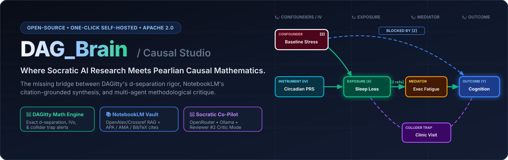
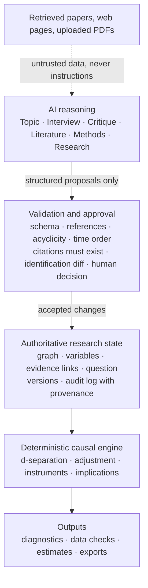

<div align="center">



# DAG Brain

**An open-source, self-hostable workspace for building causal diagrams you can defend.**

[](LICENSE)
[](pyproject.toml)
[](docs/VALIDATION.md)
[](CONTRIBUTING.md)

[What it does](#what-it-does) ·
[Three kinds of answer](#three-kinds-of-answer) ·
[Validation](#validation) ·
[How AI is kept in its place](#how-ai-is-kept-in-its-place) ·
[Quickstart](#quickstart) ·
[Privacy and local-only mode](#privacy-and-local-only-mode)

</div>

---

## What it does

A directed acyclic graph (DAG) is a researcher's causal assumptions written down. Get it wrong and the analysis inherits the error: an unmeasured confounder, a mediator adjusted away, a collider that manufactures an association.

DAG Brain puts three things in one place:

1. **A deterministic causal engine** that computes what the graph implies: which paths are open, which adjustment sets identify the effect, which variables could serve as instruments, and which independencies the data should show.
2. **Data checks and estimation**: test the graph's implications against a dataset, then estimate the effect with an adjustment set the engine has certified, using regression and double machine learning, with an E-value for unmeasured confounding.
3. **A literature and reasoning assistant** that helps you formulate the question, find and summarise evidence, and challenge assumptions. It can only *propose*; you decide.

It works for any field that asks causal questions: epidemiology, clinical research, economics, psychology, the social sciences and causal machine learning.

## Three kinds of answer

The app keeps three kinds of statement apart, because they have very different standing.

| | What it tells you | How it is established | How far to trust it |
|:--|:--|:--|:--|
| **Structural validity** | Is the graph acyclic? Do arrows respect time order? | Graph algorithms | Exact |
| **Identification** | Given *this* graph, which adjustment sets identify the effect? Which variables are instrument candidates? What independencies should the data show? | Complete graphical criteria: the generalised adjustment criterion (Shpitser et al. 2010; Perković et al. 2018), the single-door criterion (Pearl 2009), d-separation | Exact, **but only conditional on the graph being right**. Every result lists the assumptions it rests on. |
| **Scientific support** | How well supported is each arrow the identification depends on? | Your evidence: each arrow carries an evidence class and per-study assessments | A judgement. The app grades it and highlights the weakest assumptions. |

Two consequences are made explicit in the interface:

- An **instrument candidate** passes the necessary graphical conditions under your DAG. The graph cannot establish instrument strength or the exclusion restriction, so the app never calls it a "valid instrument".
- A graph is never "proven" by data. A failed implication shows the data disagree with the graph; passing tests show only consistency.

### Evidence classes

Every arrow has an evidence class, and every linked study records its design, population, whether it establishes the direction of the effect, its limitations and your assessment (supports, weakly supports, contradicts, not assessed).

| Class | Meaning |
|:--|:--|
| Experimental evidence | Relationship investigated through an intervention |
| Quasi-experimental evidence | Causal inference from a quasi-experimental design (valid under that design's assumptions) |
| Empirical association | An observed statistical relationship. Does not establish direction. |
| Mechanistic evidence | Supports a proposed mechanism, not an effect size |
| Author hypothesis | Proposed by a paper's authors, not tested there |
| Researcher hypothesis | Your own assumption |
| AI hypothesis | Proposed by the assistant, until you reclassify it |

Arrows on the canvas are drawn by class (solid for experimental and quasi-experimental evidence, dashed for associations, hypotheses and AI proposals), so the weakest links are visible at a glance. Linking a paper to an arrow never upgrades the arrow's class by itself: you decide, after recording whether the study establishes direction. Cross-sectional designs are marked "direction not established" automatically.

## Validation

The engine and estimators are checked against independent implementations and against data with a known true effect. The full report, with every number reproducible from a fixed seed, is in [**docs/VALIDATION.md**](docs/VALIDATION.md). In summary:

- **d-separation** agrees 100% with an independent moral-graph implementation and with `networkx` on thousands of random queries.
- **Adjustment sets** agree 100% with an independent implementation of the criterion's path-based definition, checked on every subset of variables in hundreds of random graphs. Existence of an adjustment set agrees with brute-force search, and every reported minimal set is valid and inclusion-minimal.
- **Exactness**: on random linear structural causal models, every set the engine certifies reproduces the true total effect to machine precision (using the exact population covariance); every set it rejects is biased.
- **Coverage**: regression adjusting for the engine's set gives 95% intervals that cover the truth at close to the nominal rate.
- **Double machine learning** removes non-linear confounding bias that ordinary regression leaves in.
- **Independence tests**: type I error and power are measured and reported for partial correlation and the generalised covariance measure, including where each over-rejects.
- Textbook graphs (M-bias, butterfly bias, mediators, front-door, instruments) give the published answers.

Reproduce it:

```bash
pip install -r requirements-dev.txt
pytest                                  # 75 tests, under a minute
python scripts/validation_report.py     # full study, writes docs/VALIDATION.md
```

## How AI is kept in its place



- The assistant **cannot change the graph or the library**. It emits proposals that are validated (schema, existing variables, no cycles, citations that resolve to real sources) and annotated with what would change in identification. You accept or reject each one, and acceptance re-validates against the current graph.
- Research runs **stage** sources for review instead of saving them. AI-proposed arrows are always "AI hypothesis".
- Every accepted change creates a **graph version** and an audit entry with the proposal id, model, provider, a hash of the prompt and the sources used.
- **Prompt injection**: retrieved text is wrapped as inert data, delimiter look-alikes are neutralised, and instruction-like content is detected and flagged. Flagged sources are excluded from automatic proposals. Because the model can only produce validated proposals, nothing a document says can change your research state on its own.
- Graph facts (paths, adjustment sets, identifiability) always come from the engine, never from the model.

## Features

- **Canvas**: drag variables, draw arrows and shared latent causes (↔), arrange by time wave, pan and zoom, keyboard control, undo.
- **Identification strip**: verdict, total or direct effect, minimal adjustment sets (click to apply), instrument candidates, warnings for mediators, colliders and descendants of the outcome, every path with what blocks it, the assumptions and the evidence grading.
- **Causal question**: a domain-neutral structure (units, exposure, comparator, outcome, time horizon, estimand) with optional framings: PICO for clinical interventions, PECO for epidemiological exposures, policy counterfactuals for economics, interventions on structural causal models for ML, and longitudinal or mediation designs for psychology.
- **Data**: upload a CSV, map columns to variables, test implied independencies (partial correlation or the generalised covariance measure, with Holm and Benjamini–Hochberg correction), and estimate the effect with HC3-robust regression with a bootstrap, plus partially linear DML or AIPW with cross-fitted gradient boosting, overlap diagnostics and E-values.
- **Literature**: OpenAlex, Crossref, PubMed/Europe PMC, CORE, optional Semantic Scholar, SerpApi (Google Scholar) and Tavily. Legal full-text discovery via Unpaywall, Europe PMC open-access links, CORE and an optional institutional EZproxy prefix. Upload your own PDFs; they stay on your machine.
- **Notebook, evidence matrix, lab briefing, worldviews** (fork and compare alternative graphs), and **exports** to DAGitty, R (dagitty/ggdag), Python (DoWhy), LaTeX TikZ and a Markdown dossier with the three tiers.
- **Citation styles**: APA 7, Vancouver, Chicago, Harvard, IEEE and BibTeX.

## Quickstart

```bash
git clone https://github.com/YOUR-USERNAME/DAG_Brain.git
cd DAG_Brain
```

| System | Command |
|:--|:--|
| Windows | `start.bat` or `.\start.ps1` |
| macOS / Linux | `chmod +x start.sh && ./start.sh` |
| Docker | `docker compose up --build -d` |
| Docker with a local Ollama model | `docker compose --profile local-ai up --build -d` |

The launcher creates a Python environment, initialises a SQLite database in `./data` with two worked examples, and opens `http://127.0.0.1:8000`.

### AI providers

Open **AI and search settings** (top right) or copy `.env.example` to `.env`. Supported: OpenRouter, Ollama (auto-detected on `localhost:11434`), Gemini, OpenAI, Anthropic, and any OpenAI-compatible server (LM Studio, vLLM). With no provider configured, a rule-based assistant still answers using the engine's results.

## Privacy and local-only mode

Using Ollama keeps *model calls* on your machine, but the app also makes other outbound requests by default: literature search, web search, Unpaywall and web fonts. To keep everything local, turn on **local-only mode** (`OFFLINE_MODE=true` or the Privacy setting). Then:

- every outbound HTTP request from the backend is refused before it leaves the process, except to `localhost` (Ollama, LM Studio) — enforced in one place, [`backend/net.py`](backend/net.py), and covered by tests;
- the interface does not load web fonts;
- uploaded datasets and PDFs stay in `./data/uploads`.

For a genuinely air-gapped deployment you must also control the host itself: no telemetry from the OS or the browser, no outbound network at the firewall, and dependencies installed from a local mirror. DAG Brain's local-only mode covers the application; it cannot certify the machine around it.

## Limitations

- Identification covers one exposure and one outcome at a time, by covariate adjustment, plus graphical instrument candidates. Front-door estimation and g-methods for time-varying treatments are not implemented.
- The direct effect uses the single-door criterion, which identifies a path coefficient in linear models; for non-linear models it is a controlled direct effect.
- Estimation supports the total effect. Implication tests can lack power, and statistically equivalent graphs cannot be told apart by data.
- AI summaries are labelled unverified until you check them against the paper.

## Documentation

- [ARCHITECTURE.md](ARCHITECTURE.md): layers, data model, algorithms and references.
- [docs/VALIDATION.md](docs/VALIDATION.md): the validation study.
- [CONTRIBUTING.md](CONTRIBUTING.md): how to contribute.

## License

[Apache License 2.0](LICENSE).
